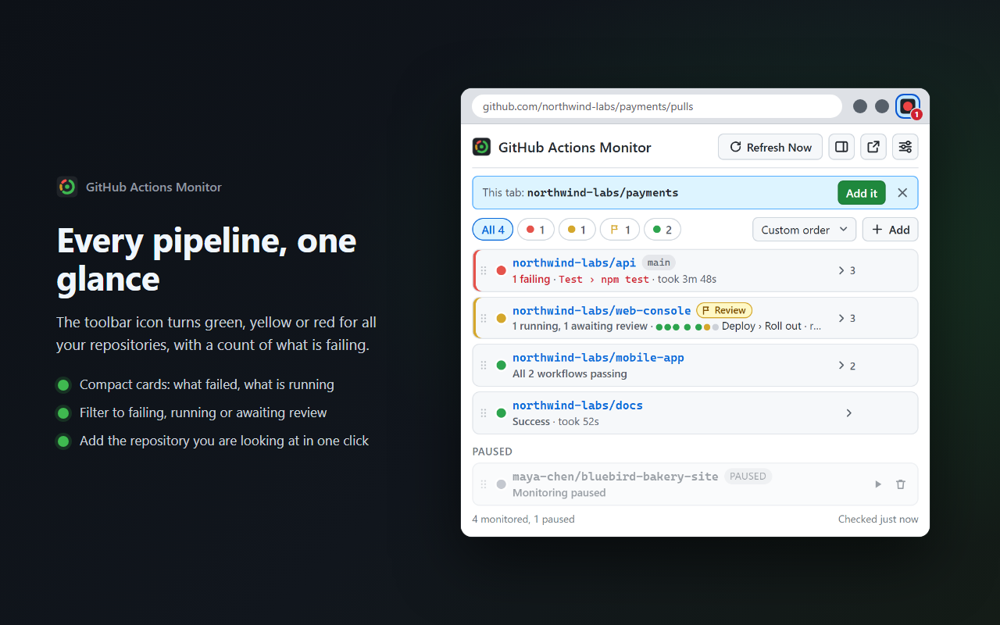

# GitHub Actions Monitor

**Your GitHub Actions status, live in the Chrome toolbar.** The extension icon turns green, yellow or red for all
the repositories you care about, and the popup tells you which workflow failed, at which step, and why.

Free and open source (GPL-3.0). No server, no analytics: it talks only to GitHub's API with your own read-only token.

[Website](https://jd2005l.github.io/GithubActionsMonitor/) ·
[Chrome Web Store](https://chromewebstore.google.com/detail/github-actions-monitor/alipppinchgegflhlgogkhbjcigbkhkl) ·
[Privacy](PRIVACY.md) ·
[Changelog](CHANGELOG.md)



## Features

- **One status light for everything.** The toolbar icon is yellow while anything runs, green when every workflow
  passed, flashing red and green when some repositories failed, red when all failed, gray with no data. A number
  on it counts failing repositories (or running ones when nothing fails).
- **Why it failed, without opening GitHub.** A failed workflow names its failed job and step ("Test › npm test")
  and quotes the lines from its log that say why ("Expected: 429 / Received: 200").
- **Compact cards.** One card per repository and branch, with summary filters (failing, running, awaiting review,
  passing). Expand a card for every workflow, its last ten runs, and the commit, pull request and author behind it.
- **Step lights and live timers.** A running workflow lights up step by step; running ones count up, finished ones
  show how long they took.
- **Every workflow counts.** The latest run of *each* workflow decides the status, so a failing CI is never hidden
  by a deploy that finished after it. Switch off noisy workflows per repository.
- **Reviews.** Runs waiting for a deployment review or an approval are marked, with a link to review them.
- **Keep it in view.** Dock it in Chrome's side panel, pop it out into its own window, or keep it on top of every
  other window (Chrome's picture-in-picture window).
- **Add the repository you are looking at** in one click from its GitHub page, or pick any owner's repository,
  private ones included. Watch all branches or a specific one; pause the ones you are not working on.
- **Desktop notifications** (optional) when a workflow starts, succeeds or fails, naming the failed step.
- **Re-run and cancel** (optional, off by default) from the expanded card.
- **Rate-limit safe.** Every check is a conditional request; when nothing changed, GitHub answers "304 Not
  Modified", which does not count against the 5,000 requests/hour limit. Checks speed up to every 5 seconds only
  while something runs.
- **Dark mode** that follows your browser or OS, and settings synced through Chrome Sync (the token stays on the
  device unless you choose to sync it).

## Install

- **Chrome Web Store (recommended):**
  <https://chromewebstore.google.com/detail/github-actions-monitor/alipppinchgegflhlgogkhbjcigbkhkl>
- **From source:** clone this repository, open `chrome://extensions`, turn on **Developer mode**, click
  **Load unpacked** and choose the repository folder (the one containing `manifest.json`). The extension has no
  build step and no dependencies; `npm run build` is only needed to produce a clean `dist/` copy.

## Setup (about two minutes)

The extension needs a GitHub personal access token. A **fine-grained token with Actions: Read-only** is all it
needs, and the settings page opens GitHub's form with that already filled in.

1. Right-click the toolbar icon and choose **Options** (or click the settings button in the popup).
2. **Choose features** (optional): the toolbar badge, notifications, and whether to show re-run and cancel
   buttons. Re-run and cancel decide the token's permission, which is why they come first. Leave them off to
   stay read-only. Click **Next**.
3. Click **Create a read-only token on GitHub** (or **Create a token with re-run and cancel**). GitHub's
   fine-grained token form opens with a name, a 90-day expiry and **Actions: Read-only** (or **Read and write**)
   set. Metadata: Read-only is added by GitHub automatically.
4. Under **Repository access** choose **All repositories** (or only the ones to monitor). For an organization's
   repositories, choose the organization as the **Resource owner**; some organizations must approve tokens first.
5. Click **Generate token**, copy it, paste it into the settings page and click **Save Token**. The extension checks
   it right away: account, token type, how many repositories it can see and the API requests left.
6. Click the toolbar icon, then **+ Add**: type an owner, pick a repository and a branch (or "All branches") and
   click **Add Repo**. On a repository's GitHub page, click **Add it** instead.

Token types it accepts:

| Token | Permission | Notes |
|---|---|---|
| Fine-grained (`github_pat_…`) | **Actions: Read-only** | Recommended. **Actions: Read and write** only if you turn on re-run and cancel. |
| Classic (`ghp_…`) | `repo` scope for private repositories | Works, but `repo` grants full read and write access to all your repositories; the token check warns about it. |

With re-run and cancel on, the token check confirms the write permission: a classic token by its scopes, a
fine-grained token by asking GitHub to cancel a run that already finished (GitHub declines either way, 409 with the
permission and 403 without, so nothing is cancelled).

## Using it

| Want to | Do |
|---|---|
| See overall status | Look at the toolbar icon (color, and the number of failing repositories) |
| See only what is failing | Click the red count above the list (click again for all) |
| See each workflow | Click the chevron on a card: workflows, history, run context |
| Open a run, or the failed job's log | Click the repository name (headline run), a workflow name, or the failed step |
| Stop a workflow from affecting the status | Expand the card and switch the workflow off |
| Re-run failed jobs, cancel a run | Expanded card, ↻ or ■ (after turning run controls on in Settings) |
| Add the repository open in the tab | Open the popup on its GitHub page, click **Add it** |
| Check now | **Refresh Now** in the popup |
| Pause or remove a repository | Hover the card: pause (resume) and remove |
| Change interval, badge, notifications, token | Settings (the sliders button in the popup) |

### How status is determined

For each monitored repository and branch, the extension reads the 50 most recent workflow runs and keeps the
**latest run of each workflow**:

- **Yellow**: any workflow is queued, waiting or in progress.
- **Red**: otherwise, any workflow's latest run failed, timed out, failed to start, or needs approval.
- **Green**: every workflow's latest run succeeded.
- **Gray**: no runs, an error, or only cancelled or skipped runs (those are shown but never turn a repository red).

Workflows switched off on a card are left out. Naming the failed job and step costs one extra request per failed
run, once: the answer is remembered while the run is shown.

### Polling and the rate limit

- **Normal mode** checks at your interval (30 seconds to 5 minutes, default 30 seconds). **Fast mode** checks
  every 5 seconds while anything is yellow, then returns to normal.
- Checks are conditional requests with ETags, so an unchanged repository costs nothing against the rate limit.
  The settings page shows the last check, how many requests were free, and the remaining limit.
- If the limit is reached anyway, checking pauses until it resets and the popup shows when.

### Troubleshooting

| Symptom | What to do |
|---|---|
| Status shows "Bad token" | Settings, **Test Token**. Create a new one with the button if it expired or was revoked. |
| "Repo not found or no access" | Check `owner/repo`, and that the token's Repository access includes that repository (or its organization). |
| Organization repositories missing | Create the token with that organization as Resource owner; the organization may need to approve it. |
| Icon not changing | **Refresh Now**; check the service worker console (`chrome://extensions`, Details, Inspect views). |
| Rate limited | The banner shows when checking resumes. Pause repositories you are not working on. |

## Privacy

The extension talks only to GitHub's API (`api.github.com`). There is no server, no analytics and nothing sent to
the developer. The token is stored in `chrome.storage.local` (or Chrome Sync, only if you turn that on).

| Permission | Why |
|---|---|
| `storage` | Your repository list and settings (synced), the token, last results and the ETag cache (on this device). |
| `alarms` | Periodic background checks. |
| `notifications` | Optional desktop notifications on status changes. |
| `sidePanel` | Dock the popup in Chrome's side panel. Shows only the extension's own page. |
| `activeTab` | When you open the popup, read the current tab's address once to offer that repository. Not stored or sent anywhere; no access to page content. |
| `https://api.github.com/*` | Read workflow runs, jobs, branches and repository names; re-run and cancel runs only if you turn run controls on. |

Full policy: [PRIVACY.md](PRIVACY.md), also published at <https://levac.net/actions-monitor/privacy.html>.

## Development

The files at the repository root are what ships; the Node tooling only builds, tests and packages them.

```bash
npm ci
npx playwright install chromium   # once, for the browser tests
npm test              # unit tests (node --test): status logic, conditional requests, ordering
npm run test:e2e      # browser tests: dist/ in Chromium against a mock GitHub API
npm run check         # both
npm run package       # Chrome Web Store folder: release/chrome-web-store-<version>/ (zip, listing, screenshots)
```

- `scripts/build.mjs` copies exactly the shipped files into `dist/` (and, with `--store`, zips them).
- `tests/e2e/mock-github.mjs` is a small fake GitHub API (runs, jobs, logs, branches, repositories, ETags with free
  304s, rate-limit headers) that answers the service worker during browser tests. No real account is used.
- `site/` is the project website, published to GitHub Pages by `.github/workflows/pages.yml`.

```
manifest.json          Extension manifest (MV3)
background.js          Service worker: polling, adaptive speed, notifications, icon updates
github-api.js          GitHub API: conditional requests, per-workflow status, token check
icon-manager.js        Status aggregation and the dynamically drawn toolbar icon
storage-manager.js     Sync vs local storage, migrations, ETag cache, poll statistics
popup.html/.js/.css    Popup: summary, compact cards, workflows, history, timers, add/pause/remove, run controls
options.html/.js/.css  Settings: setup steps, interval, badge, notifications, run controls, API usage, how it works
repo-order.js          Custom order and sorting of the repository list
icons/                 Static icons (the toolbar icon is drawn at runtime)
scripts/               Build, icons, packaging and store-listing generation
tests/                 Unit, browser and store-screenshot tests
site/                  Project website (GitHub Pages)
```

## Contributing and support

Issues and pull requests are welcome: <https://github.com/JD2005L/GithubActionsMonitor/issues>. Run `npm run check`
before sending a change. GitHub Actions Monitor is free with nothing held back; if it saves you time, you can
[sponsor its upkeep](https://github.com/sponsors/JD2005L).

More by the author: [Inbox Pilot](https://jd2005l.github.io/InboxPilot/) (ask ChatGPT about your Gmail) and
[GitHub Repo Navigator](https://jd2005l.github.io/GitHubRepoNavigator/).

## License and name

The code is licensed under the [GNU General Public License v3.0](LICENSE): you may use, study, change and share it,
and anything you distribute that is based on it must be released under the same license, with its source.

The license covers the code, not the name. "GitHub Actions Monitor" and its status-ring icon identify the official
release by James Levac; if you publish a fork (for example on the Chrome Web Store), give it a different name and
icon so people can tell them apart.

Not affiliated with or endorsed by GitHub. GitHub is a trademark of GitHub, Inc.
